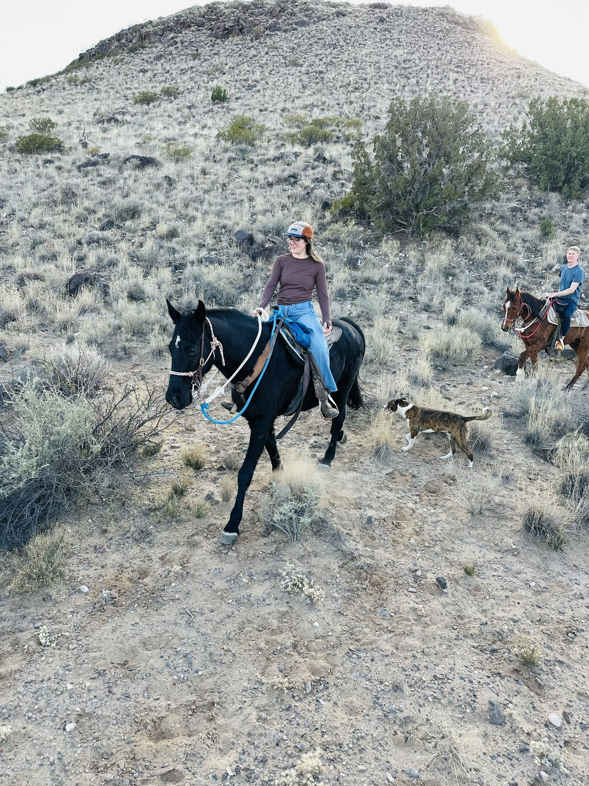
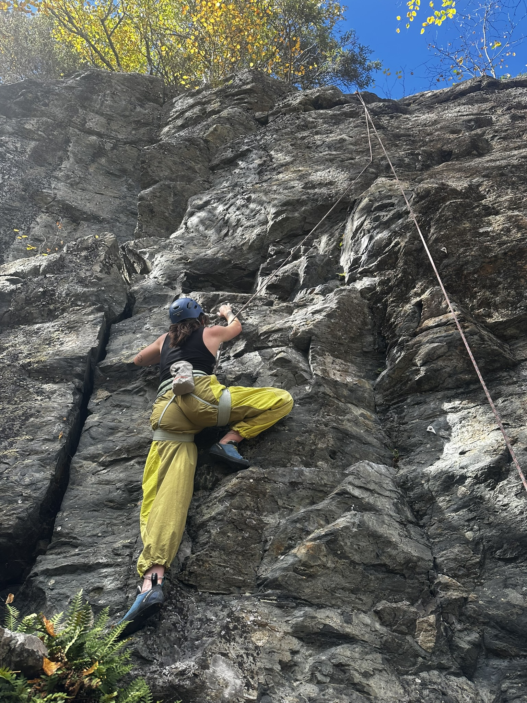
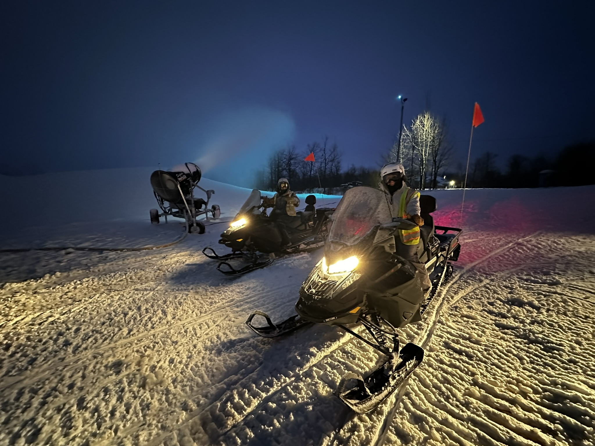

## About Me

{style="float:left; margin-right: 5%; fig-align:left; width:45%;" fig-alt="\"Photo of Kelly Ahern on a horse in the desert."}

{style="float:right; margin-left: 5%; fig-align:right; width:45%;" fig-alt="\"Photo of Kelly Ahern in green pants rock climbing."}

Although I grew up in the Chicago suburbs, I was fortunate enough to have a family that instilled in me the importance of nature. I visited my first national park (Smoky Mountains National Park) in 2004, and haven't stopped looking for more beautiful places to visit since then. I have been to 26 American, 2 Canadian, and 2 Irish national parks.

Although I spend a lot of time in the field working, I also enjoy climbing, horseback riding, and paddleboarding whenever possible. I have worked at several ski resorts after my undergraduate studies and I love snowboarding and snowmobiling.

{style="float:right; margin-left: 5%; fig-align:right; width:100%;" fig-alt="\"Photo of two people on snowmobiles."}

Find me on instagram: [@ahern_kelly](https://www.instagram.com/ahern_kelly/)

#### About this site

I have created this site as an addendum to my resume to track and share my professional, personal, and educational developments. 

Special thanks to Randy Swaty of The Nature Conservancy for his assistance in teaching me GitHub, Quarto, and his patience in helping me build this site.
