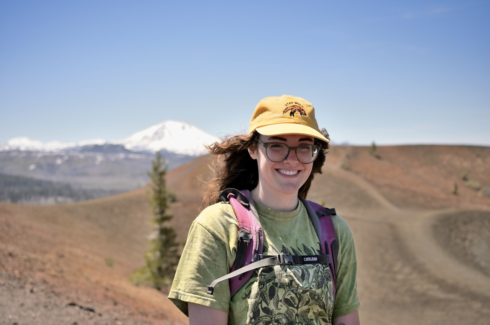

{style="float:right; margin-left: 5%; fig-align:right; width:55%;" fig-alt="\"Photo of Kelly Ahern in a green shirt with Lassen Peak in the Background."}

I am a Master's student at Université du Québec en Abitibi-Temiscamingue, located in Rouyn-Noranda, Québec. My degree is in ecology and management of forest ecosystems. I am currently pursuing a research degree focusing on carbon storage in old-growth boreal forest. \

I hold a B.S. in Biology with a concentration in Ecology from Northern Michigan University, and I have multiple seasons of field work experience. Most of my career has focused on understory botany in various ecosystems throughout the United States. \

I am experienced with vascular plant identification, ecological data collection, and invasive species management techniques. I am proficient in various softwares, including Field Maps, ArcGIS, and R/Rstudio.\

